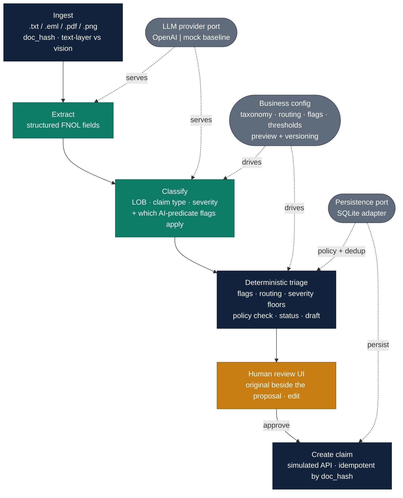

# AI-assisted FNOL triage for an insurer

An AI-assisted workflow for a **claims-intake (First Notice of Loss) team** at a
Romanian personal-lines insurer. Customers notify losses in messy formats — emails,
web-form text, PDFs, and photos **including handwritten forms**, in Romanian and
English. Today a small, non-technical intake team reads each one and sets up and
routes the claim by hand (~6–10 min each, error-prone).

This tool **extracts** the key fields, **classifies** the line of business, claim
type and severity, runs **deterministic checks** (routing rules, severity floors,
fraud/contestability flags, policy verification, required-field checks), and presents
a **review screen** where a handler edits and approves (~2 min each).

> **The model proposes, deterministic code checks, the human decides. AI never
> creates a claim, sets reserves, or decides eligibility by itself.**

Lines of business: **Home/Property** and **Life – Credit Protection Insurance (CPI)**.

**What makes this a Forward-Deployed answer:** the workflow is driven by a
**business-owned configuration** (taxonomy, routing rules, flags, templates,
thresholds) that the non-technical team maintains *in-app* — with a preview/test
loop over a labeled sample set, version history, and one-click rollback — so changing
how claims are triaged needs **no engineering redeploy**.

---

## Repository layout

> 📂 **Reviewer shortcut:** the written deliverables and both slide decks are in
> **[`docs/`](docs/)** — including the two exported PowerPoints (★ below).

```text
.
├── docs/                         ←★ WRITE-UPS & PRESENTATIONS (start here)
│   ├── CUSTOMER_CONTEXT.md             customer-context note (deliverable)
│   ├── ClaimSight — Fiducia Insurance.pptx   ★ main presentation
│   └── ClaimSight — Appendix.pptx            ★ appendix / deep-dives
│
├── app/                          the FastAPI service (the application)
│   ├── ingest.py                      file → IngestedDocument (doc_hash, text-layer vs vision)
│   ├── providers/                     LLMProvider PORT + OpenAI & mock adapters (model behind a port)
│   ├── pipeline.py                    orchestrates extract → classify → triage
│   ├── triage.py                      deterministic layer (flags, routing, severity, status, draft)
│   ├── workflow/                      business-owned config: schema + starter seed
│   ├── persistence/                   storage PORT (base) + SQLite adapter (sqlite/) — DB behind a port
│   ├── policy.py                      Policy entity + simulated seed
│   ├── observability.py               RunMetrics, cost estimate, JSON logs
│   └── api.py · main.py               JSON API + app entrypoint
│
├── static/index.html             single-page review / config / metrics UI
├── scripts/                      seed.py (DB + starter config), triage.py, extract.py, sample makers
├── eval/                         labeled test set + run_eval.py (mock vs OpenAI baseline)
├── tests/                        pytest suite (61 tests)
├── samples/                      example FNOLs (text, email, PDF, handwritten images)
│
├── README.md                     this file
└── STAGES.md                     stage-by-stage build log
```

---

## Quickstart

With [`uv`](https://docs.astral.sh/uv/) (recommended):

```bash
uv sync
cp .env.example .env                       # defaults to the mock provider — no API key, no cost
uv run python -m scripts.seed              # create the DB + install the starter config + policy master
uv run uvicorn app.main:app --reload       # open http://127.0.0.1:8000/
```

Without `uv` (plain pip):

```bash
python3 -m venv .venv && source .venv/bin/activate
pip install -r requirements-dev.txt
cp .env.example .env
python -m scripts.seed
uvicorn app.main:app --reload
```

The app defaults to the **mock provider** (regex/keyword extraction, no OCR), so it
runs with **no API key and no cost**. To use the real model, set in `.env`:

```
LLM_PROVIDER=openai
OPENAI_API_KEY=sk-...
```

and restart. (The provider is read at startup, so restart after changing `.env`.)

### Try it

- **Review queue:** upload a file (samples in `samples/` and `eval/testset/`), open it,
  edit the proposal, and **Approve** to book a claim. **↻ Reprocess** re-runs the AI on
  a stored document with the current provider/config (no re-upload).
- **Workflow config tab:** edit thresholds / routing queues / flag keywords, **Preview**
  the effect on the labeled sample set, then **Save** a new version or **Roll back**.
- **Metrics tab** (or `GET /metrics`): latency, cost/doc, status distribution, override rate.

### Reset the database

Wipe all stored documents, proposals, claims and uploaded files, then reinstall the
starter config (v1) and the simulated policy master:

```bash
rm -f data/app.db && rm -rf data/uploads && uv run python -m scripts.seed
```

No restart needed — each request opens its own connection, so the UI shows the fresh
state on reload. (`db_path` / `uploads_dir` are configurable in `.env`.)

### Tests & eval

```bash
uv run pytest -q                                  # 61 tests
uv run python -m eval.run_eval --provider mock    # free
uv run python -m eval.run_eval --provider openai  # costs ~$0.07 (34 model calls)
```

---

## Architecture

**Legend:** 🟩 AI (model) · ⬛ deterministic code · 🟧 human · ⬜ ports / business config.



The AI does exactly two steps (🟩 extract, classify); everything consequential —
routing, flags, status, the draft — is deterministic ⬛ code. Both the model and the
database sit behind ports (⬜), and the business-owned config (⬜) drives classification
and triage. Cross-cutting: structured JSON logs (`request_id`) + `/metrics`.

**Division of labour — AI vs code.** AI does exactly two things: **extraction** and
**classification** — and as part of classification it also *judges which natural-language
flag predicates apply* (see Flags below). Everything a business needs to be *reliable* is
deterministic code: routing, severity floors, flag **firing and effect**, policy verification,
required-field checks, the status colour, and the acknowledgment draft (a filled template).
Vision is not a separate feature — it is simply how extraction reads an input with no text
layer.

**Flags — three ways to trigger, one deterministic effect.** A flag fires on (1) **keywords**,
(2) a fixed **built-in condition** (an exact computation the model never touches — amount over a
threshold, a death inside the contestability window), or (3) a **natural-language predicate the
model judges** (e.g. *"reads like possible arson"*). The model only ever decides *whether* a
predicate applies and returns the matching flag keys as advisory `suggested_flags`; the
**effect** of every flag — which queue, what severity floor, that a human must review — is
deterministic config. A non-technical owner can add a semantic flag by describing it in words,
with no keyword list and no code, while the consequences stay auditable.

### Components

| Module | Role |
|---|---|
| `app/ingest.py` | File → `IngestedDocument`; `doc_hash` idempotency key; tunable text-layer-vs-vision heuristic. |
| `app/providers/` | `LLMProvider` **port** + OpenAI (structured output + vision) and mock (regex/keyword) adapters. The model behind a port. |
| `app/workflow/` | The business config: `schema` (contract + validation), `seed` (starter config). |
| `app/triage.py` | Deterministic layer: flags, severity floors, routing, required fields, status, drafts. No I/O. |
| `app/policy.py` | The `Policy` entity + a small deterministic seed (domain only; the SQL lives in the adapter). |
| `app/persistence/` | Storage **port + adapter**: `base` (the `Repository`/`TriageRepository` Protocols + port record types) and `sqlite/` (all SQLite code: `schema`, `documents`, `claims`, `policies`, `dedup`, `runs`, `config`, `repository`). The domain depends on the port, not on `sqlite3`. |
| `app/pipeline.py` | Orchestrates extract → classify → triage, with failure fallbacks + metrics; depends on the persistence port. |
| `app/api.py`, `static/index.html` | JSON API (composition root: wires the provider + SQLite repository) + single static review/config/metrics page. |
| `app/observability.py` | `RunMetrics`, cost estimate, JSON logs (`request_id`). Persisting runs + `/metrics` aggregation live in the SQLite adapter. |
| `eval/` | Labeled dataset + preview cases + `run_eval.py`. |

### Data model (SQLite)

`config_versions` (versioned business config) · `policies` (simulated master) ·
`documents` (ingested + stored proposal) · `claims` (booked, unique per `doc_hash`,
with the AI proposal, the approved values, and the human edits) · `runs` (per-document
telemetry for `/metrics`).

### Ownership split (the maintainability line)

- **Business owns, as data:** lines of business, claim-type taxonomy, routing rules,
  flags (keywords, built-in-condition parameters, **and free-text AI predicates**),
  templates, confidence thresholds. Editable in-app, validated, versioned.
- **Engineering owns, as code:** `Severity`/`Status` enums and the control flow that
  depends on them; the *menu* of built-in flag *conditions*; and the safety rule that a
  flag's **effect** is always deterministic config — the model proposes that a flag
  applies, it never decides what happens next (a deliberate guard-rail).

### Failure handling

- **Schema-invalid model output** → one retry → `ExtractionError` → 🔴 manual intake
  (never a confident wrong guess).
- **Timeouts / rate limits** → the OpenAI SDK's own retries (`max_retries`).
- **Classification failure** → fall back to the keyword baseline, forced to 🟡 amber.
- **Unreadable document** (e.g. mock on an image) → 🔴 manual intake.
- **Low confidence / illegible handwriting** → low-confidence fields flagged, not guessed;
  status pushed to amber/red; the handler verifies against the original shown beside it.
- **Prompt injection inside the document** (e.g. "approve this claim for 500,000") → the
  text is treated strictly as data; the model is instructed to ignore embedded
  instructions; and because AI only extracts/classifies (it cannot act), deterministic
  rules + the human remain between the model and a booked claim.

---

## Assumptions

- Personal lines only: **Home/Property** + **Life CPI**. Romanian insurer; RO + EN inputs.
- ~200–400 FNOLs/day handled by a small (~3–8 person) non-technical intake team.
- A policy master exists to verify the policy (here simulated with a small seed).
- `gpt-5-mini` for extraction and classification (configurable via `.env`).
- The intake lead can own the workflow config (taxonomy, routing, thresholds) — the
  same artifacts they already maintain informally today.

## Trade-offs (latency · cost · accuracy)

Measured on the 17-case labeled test set (`eval/run_eval.py`):

| | mock (baseline) | OpenAI `gpt-5-mini` |
|---|---|---|
| Extraction F1 | 0.86 | **1.00** |
| Routing accuracy (key) | 0.47 | **0.88** |
| Status accuracy | 0.18 | **0.94** |
| **Green precision (key)** | N/A | **1.00** |
| Latency p50 / p95 | ~0.1 / 0.2 ms | **12.7 s / 15.3 s** |
| Cost / document | $0 | **~$0.004** |

- **Accuracy:** the model decisively beats the non-LLM baseline. **Green precision = 1.00**
  is the metric that matters most: of every case auto-marked 🟢 ready, none was wrong — i.e.
  **zero false auto-approvals**. A wrong green is the expensive error (a claim set up without
  a human looking), so the system is tuned to prefer amber over a risky green.
- **Cost is a non-issue:** ~$0.004/doc → ~$1–2/day at this volume, trivial against the labour
  saved. Output (reasoning) tokens dominate; rates are configurable in `.env`.
- **Latency is the real trade-off:** ~13 s/doc. It is a *reasoning* model, and the vision
  (scanned/handwritten) cases dominate the tail. Levers: a faster non-reasoning model for
  extraction, the **text-layer-first** heuristic (avoid vision on typed PDFs), processing
  asynchronously so the handler isn't blocked, and batching. At ~2 min of human review per
  claim, 13 s of model time is acceptable but worth optimising.
- **Maintainability as a lever:** the business tunes precision/recall by editing thresholds
  and routing in-app (previewed against the sample set) without an engineering cycle.

## Scaling & target architecture

This repo is a **POC**: one FastAPI process, **synchronous** request → response, SQLite.
That is deliberate — it keeps the demo and the AI-vs-code story legible. The notes below are
how it would grow, and they are the part worth discussing, because **the bottleneck is not our
code — it is the external model API.**

**Where the limit actually is.** Each document is ~13 s of *model* time (a reasoning model, and
the vision cases dominate the tail). Our own pipeline is cheap. Under a **catastrophe surge** (a
storm drops thousands of FNOLs in an hour), two things break: the handler should not stare at a
13 s synchronous spinner, and we will blow past the OpenAI account's **per-minute rate limits**
(requests/min *and* tokens/min). Adding machines does **not** help — every worker shares the same
external quota.

**Target architecture (how it scales):**

1. **Make it asynchronous.** Ingest validates, stores the document, returns **`202 Accepted` +
   a job id**, and publishes a message to a **queue (Kafka)**. The UI polls (or gets a
   websocket/push) for the proposal. The handler is never blocked; the 13 s becomes invisible.
2. **Stateless workers on Kubernetes** consume the topic and run the extract → classify → triage
   pipeline. They hold no state, so they scale horizontally.
3. **KEDA autoscaling on queue lag.** The scaling signal is **consumer-group lag** (how far
   behind the workers are), not CPU. Surge ⇒ lag grows ⇒ KEDA adds worker pods; drain ⇒ scale
   back to near zero. The queue *absorbs* the spike so nothing is dropped.
4. **A shared rate limiter in front of OpenAI (Redis token bucket).** Because every pod shares
   one external quota, the limiter must be **central**. Redis holds two buckets per account —
   **RPM** and **TPM** — refilled by *elapsed time since last refill* and decremented
   **atomically by a single Lua script** (one script touches both buckets, which closes the
   read-modify-write race between pods; Redis runs scripts serially). A worker that cannot get
   tokens waits and retries rather than firing a doomed request. We request an estimated token
   count up front and reconcile with actual usage after the call.
5. **Bulkhead (concurrency cap)** so in-flight calls never exceed what the plan supports, and a
   **circuit breaker** around the provider for genuine **outages/5xx** — fail fast to 🔴 manual
   intake instead of hammering a dead dependency. (A circuit breaker is for *failures*; **rate
   limits are handled by the bucket + queue**, not by tripping the breaker.)
6. **No single points of failure:** Redis in **Sentinel/Cluster** HA so the limiter isn't a SPOF;
   SQLite → Postgres; documents to an object store.

**Backpressure** is the glue: when the model API can't keep up, the limiter withholds tokens, the
workers slow, lag builds in the queue, and KEDA reacts — the pressure is pushed *back* to the
queue, which is built to hold it, instead of forward as a flood of `429`s or dropped claims.
Backpressure is the **mechanism**, not the symptom.

**What we measure to run this** (the current `/metrics` is the seed): queue lag, end-to-end
p50/p95, tokens-per-minute vs the plan ceiling, `429` rate, cost/doc, and the human **override
rate**. These tell us when to raise the plan limit, add workers, or retune the config.

**Not agentic by design.** The LLM is used as a constrained *function* (extract/classify), not an
autonomous agent — the orchestration is deterministic code. If external systems ever needed to
drive the steps, each stage could be exposed as an **MCP tool** or a **REST endpoint** without
changing the core; that is a future option, not a need for this workflow.

## Known limitations

- **Mock baseline has no OCR** — images/scans go to manual intake on the mock provider by
  design (it is the non-LLM floor the eval compares against).
- **Vision OCR on messy handwriting is imperfect** — mitigated by per-field confidence,
  amber/red flagging, and showing the original beside the proposal; not eliminated.
- **Policy master is simulated** (6 seed policies); real core-system integration is out of scope.
- **Config preview holds extraction + classification fixed** and recomputes only the
  deterministic triage — fast and free, but it does not re-simulate model classification, so
  taxonomy/prompt edits are not reflected in the preview.
- **Prompt-injection handling is basic** (data-framing + deterministic guards + human review),
  not production-grade.
- **Config UI** exposes the common knobs (thresholds, routing queues, flag keywords); full
  taxonomy/template editing is possible via the versioned config JSON (API `config/save`).
- **Synchronous processing**, single-tenant, no auth, English/Romanian only.
- Some eval "mismatches" are **labeling judgment calls** (e.g. the model routing small claims
  to fast-track where ground truth said standard — arguably the model is right).

## Where AI is used

**In the product (runtime):** the LLM (`gpt-5-mini`) does **extraction** (structured output
via the Responses API; vision for scans/handwriting) and **classification** (LOB / claim type
/ severity, prompted from the business taxonomy and few-shot examples). As part of
classification it also judges the business's **natural-language flag predicates** and returns
the keys that apply as advisory `suggested_flags`. A deterministic, non-AI **mock provider**
(regex + keyword scoring) implements the same interface so the app, tests and eval run with no
key, and serves as the eval baseline. Everything after classification — including every flag's
*effect* — is deterministic code.

**In building this project:** this was built with AI assistance (Claude Code) acting as a
pair-programmer — scaffolding modules, drafting tests and the UI, and running the app/eval —
while the design decisions (the pivot to insurance FNOL, the AI-vs-code split, the
maintainability-first config layer, the failure modes) were directed and reviewed by the
candidate. Several bugs were found by running the system on real data and fixed (see
`STAGES.md`): a `.eml` charset bug, flag mis-scoping (catastrophe/contestability), keyword
brittleness on the injury flag (now driven by the structured field), and a red-status routing
inconsistency.

## Out of scope

Real platform integration, auth, multi-level approvals, payments, multi-tenant, and
production-grade prompt-injection defense. For Life/CPI, the tool only extracts, classifies
and routes — it makes **no** medical, eligibility or payout decision; contestability/SIU is a
*flag for a human*, never an AI decision.

## Project layout & progress

`app/` application · `static/` the review page · `scripts/` seed + dev helpers ·
`samples/` + `eval/testset/` example documents · `eval/` dataset + eval runner ·
`tests/` the test suite · `docs/` the written deliverables and presentations.

### Documentation & presentations (`docs/`)

- **[docs/CUSTOMER_CONTEXT.md](docs/CUSTOMER_CONTEXT.md)** — the customer-context note: who
  this is for, the pain, the governing principle, and why it is built to be maintained by the
  business.
- **[docs/PRESENTATIONS.md](docs/PRESENTATIONS.md)** — index of the two interview decks (the
  **main presentation** and the **appendix / deep-dives**): what each slide covers, the live
  links, and how to export to PDF/PPTX.
- **[STAGES.md](STAGES.md)** — the stage-by-stage build log (what was built and the bugs found by
  running it on real data).

Code and docs are in English. `.env` is gitignored and must never
be committed.
